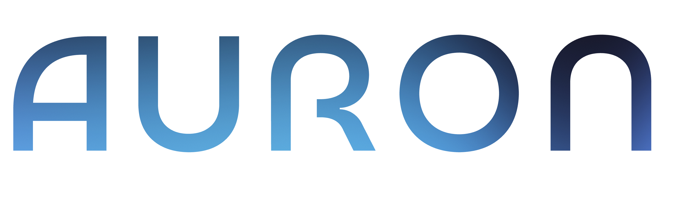
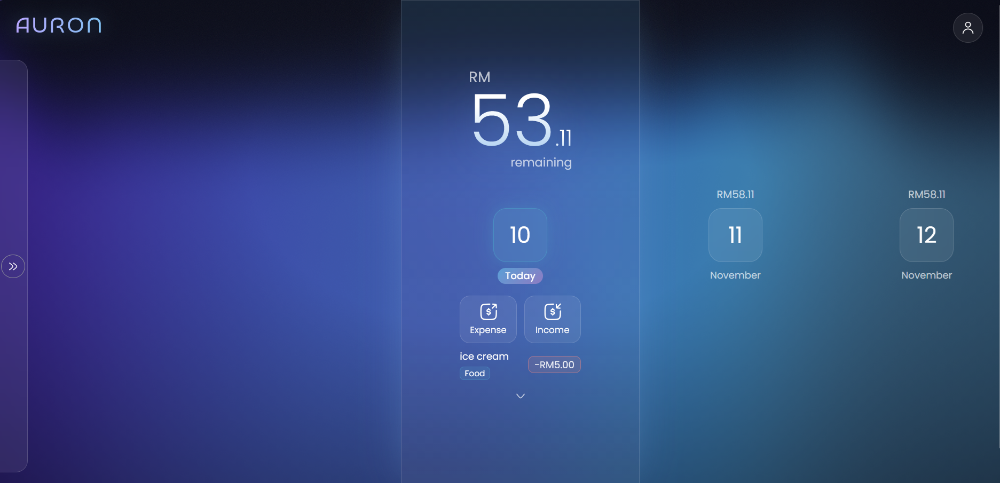

# 

A project built to help people stick to a daily budget and save their spare money.

Features include:
- Login and registration with Supabase Auth
- OAuth support to allow registration or logging in via Google
- Monthly setup that turns a monthly allowance into a daily budget
- Scrolling day strip that shows each day's remaining budget and latest expenses
- Log, edit and delete expenses, either deducted from today or spread over the rest of the month
- Log incomes, either added to today or spread over the rest of the month
- Currency rates page with a currency converter, using daily rates from the Frankfurter API
- User profile page

Built with:
- JavaScript (ES6)
- PostgreSQL
- React
- HTML
- CSS
- Bootstrap

Deployed with:
- Vercel: For frontend and backend service
  - Backend service can be found here: https://github.com/cswong235/auron-backend
- Supabase: For database hosting

## Links
- Vercel link: https://auronsaver.vercel.app/
